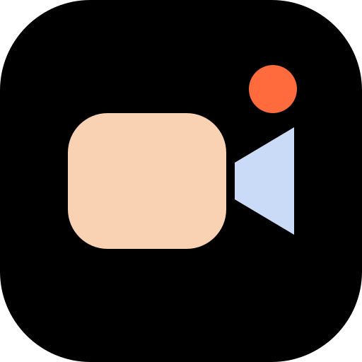
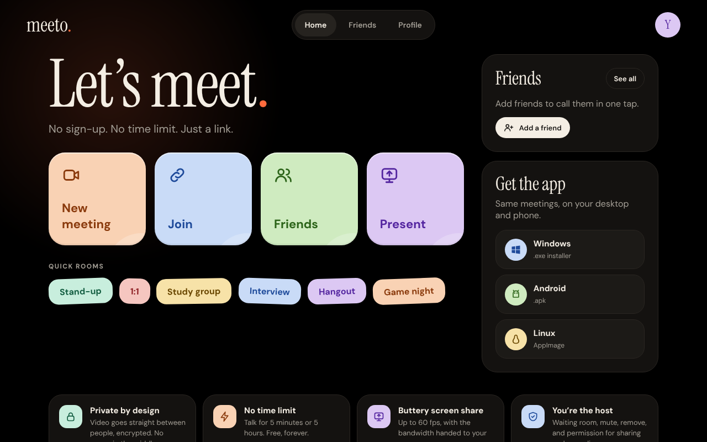
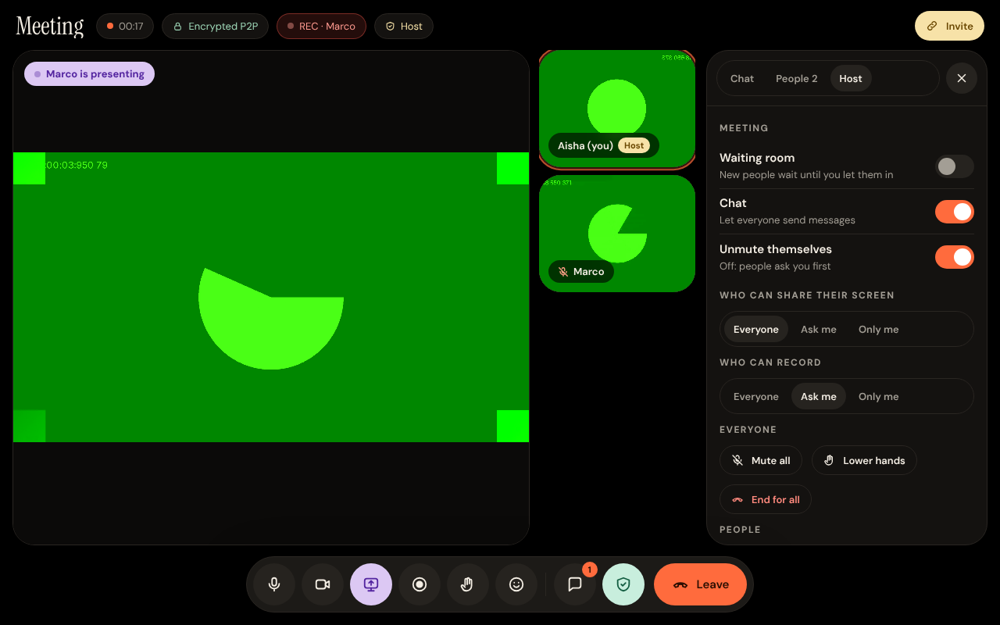

<div align="center">



# meeto.

**Free, open-source, peer-to-peer video meetings.**
No account. No time limit. No server in the middle.

### [meetop2p.vercel.app](https://meetop2p.vercel.app)

<a href="https://github.com/rayan-afkkk/meeto/releases/latest/download/Meeto-Setup.exe"></a>
&nbsp;
<a href="https://github.com/rayan-afkkk/meeto/releases/latest/download/Meeto.apk"></a>

<a href="https://github.com/rayan-afkkk/meeto/releases/latest/download/Meeto.AppImage"></a>
&nbsp;
<a href="https://meetop2p.vercel.app"></a>

<sub>Click a button and the download starts. Every push builds fresh apps, see <a href="https://github.com/rayan-afkkk/meeto/releases">Releases</a>.</sub>

<br /><br />



</div>

## Why Meeto beats Zoom

| | Zoom (free) | **Meeto** |
|---|---|---|
| Join a call | App download, often an account | Click a link. Name + go |
| Time limit | 40 minutes for group calls | **None** |
| Privacy | Video goes through Zoom's servers | **Peer-to-peer**, encrypted (DTLS-SRTP), nothing stored on a server |
| Screen share | Fixed quality | **Smooth 60 fps mode** or **Sharp text mode**, bandwidth handed to the screen |
| Host controls | Yes | Waiting room, mute, stop video, stop share, remove, end for all |
| Recording | Host/cloud | Anyone can **ask the host** for permission. A **REC badge** shows for everyone |
| Friends | Contacts tied to an account | Friend codes, online status, **one-tap calling**, no email or phone |
| Cost | Paid tiers | Free & MIT-licensed |



## Features

- **Meetings by link**: `New meeting` makes a room; send friends the 8-character code (like `kmpq4827`).
- **Profile picture & name**: set once, stored only on your device, shown to people in your calls.
- **Smooth screen share**: up to 1080p / 60 fps. *Smooth* mode keeps frame rate on bad networks (great for videos and scrolling); *Sharp* mode keeps text crisp. While someone is sharing, cameras automatically use less bandwidth so the share stays fluid. The desktop app has a native "share what?" picker for screens and windows.
- **In-call chat**: messages go straight from person to person over the P2P connection, so they only exist during the call.
- **Host controls** (the person who created the room):
  - Waiting room: people wait until you let them in
  - Who can share their screen: everyone / ask me / only me
  - Who can record: everyone / ask me / only me. Viewers **request recording permission**; you approve or deny
  - Chat on/off, let people unmute themselves or make them ask
  - Mute, stop video, stop screen share, stop recording, lower hand, or remove anyone; mute all; end for all
- **Recording**: records the meeting (all voices + video grid or shared screen) to a `.webm` file on your own computer.
- **Friends**: add by friend code or straight from a call, see who's online, call a friend and their app rings.
- **Raise hand, reactions, speaking indicator, mobile layout.**

## How it works (no Firebase, no accounts)

```
  You ──── encrypted audio / video / chat (WebRTC) ──── Friend
    \                                                     /
     `── public Nostr relays only help you find each other ─'
```

- **WebRTC mesh**: everyone connects directly to everyone else. Media never touches a Meeto server, because there isn't one.
- **Signaling via [Trystero](https://github.com/dmotz/trystero)** over public Nostr relays: they pass the tiny "here's how to reach me" messages, then step out of the way.
- **Who's the host?** Creating a room generates a key pair, and the room code is a hash of the public key. The host proves ownership by signing; everyone verifies. No server needs to know.
- **Friends** each listen on a small P2P "inbox" named after their friend code.
- Mesh calls are best for **up to ~8 people**. Bigger rooms would need an SFU (see roadmap).
- On networks that block the public relays, point Meeto at your own relay: open `…/?relay=wss://your-relay.example`.

## Run it yourself

```bash
npm install
```

```bash
npm run dev
```

Build the website (`dist/`), the desktop app, or the Android project:

```bash
npm run build
```

```bash
npm run dist:win
```

```bash
npm run dist:linux
```

```bash
npx cap add android && npx cap sync android
```

GitHub Actions (`.github/workflows/build.yml`) builds the **Windows .exe**, **Android .apk** and **Linux AppImage** on every push and attaches them to a GitHub Release, which is what the download buttons point to. The website is hosted on [Vercel](https://meetop2p.vercel.app): import the repo, framework preset **Vite**, output directory `dist`.

> The Windows installer and APK are not code-signed yet, so Windows SmartScreen / Android will ask you to confirm the install.
> Screen sharing isn't available inside the Android app (Android WebView limitation). Join from the browser on Android to view shares; presenting works on desktop.

## Tech

React 19 · TypeScript · Vite · Trystero (WebRTC + Nostr) · Electron (desktop) · Capacitor (Android) · Web Crypto (host keys) · MediaRecorder (recording)

```
src/
  lib/meeting.ts    P2P meeting engine: peers, media, host permissions, chat, screen share tuning
  lib/hostKeys.ts   room ownership via ECDSA signatures
  lib/inbox.ts      friends: requests, online status, calls
  lib/recorder.ts   local meeting recording
  pages/            Home, Room (lobby + call), Friends, Profile
electron/           desktop wrapper + native screen picker
```

## Roadmap

- [ ] Optional SFU (LiveKit) for 20+ person meetings
- [ ] On-device live captions & AI meeting recap
- [ ] Shared whiteboard / drawing on screen shares
- [ ] Code-signed Windows & macOS builds, Play Store listing

## License

MIT
